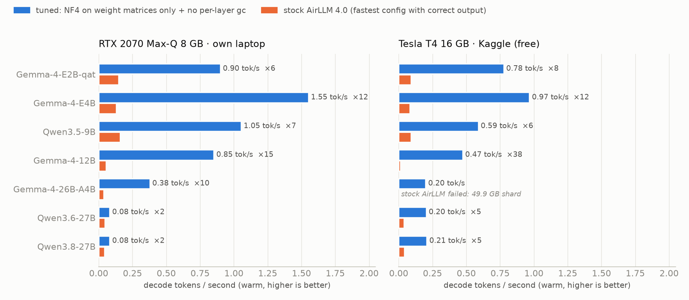
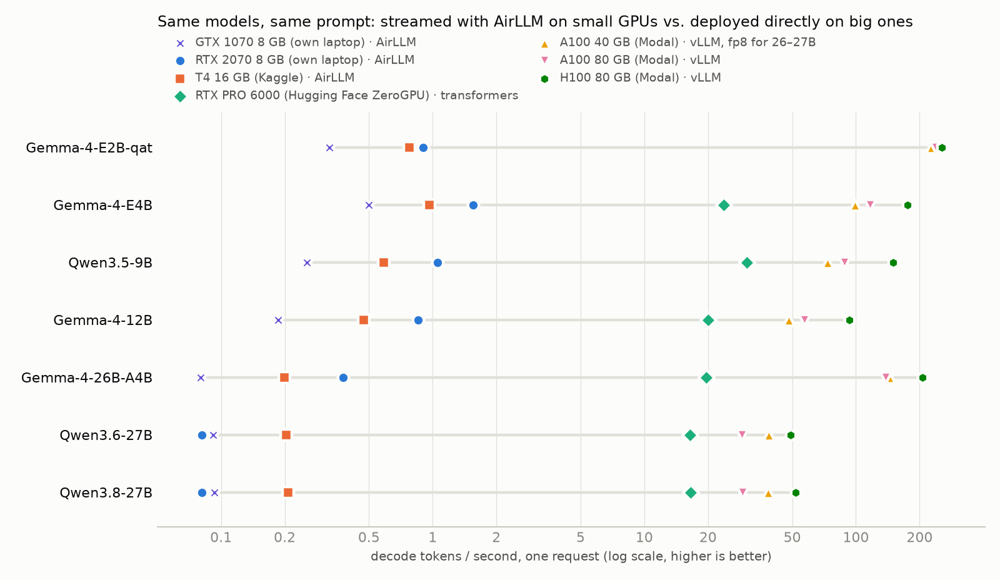

# AirLLM benchmarks: Gemma 4 and Qwen 3.x on small GPUs

Can [AirLLM](https://github.com/lyogavin/airllm) (v4.0.0, Sept 2026) run current open models on
**8 GB laptop GPUs** (RTX 2070 Max-Q on Linux, GTX 1070 Max-Q on Windows) and on a **free T4 from
Kaggle**, and how fast? And how does that compare with simply deploying the same models on a GPU big
enough to hold them ([an RTX PRO 6000 from Hugging Face ZeroGPU, and A100 / H100 rented on Modal with
vLLM](#bigger-gpus-deploy-directly))?

| GPU | Provider | Used for |
|---|---|---|
| RTX 2070 Max-Q 8 GB | own laptop (Linux) | AirLLM, stock and tuned |
| GTX 1070 Max-Q 8 GB | own laptop (Windows 11) | AirLLM, tuned |
| Tesla T4 16 GB | **Kaggle** (free notebook) | AirLLM, stock and tuned |
| RTX PRO 6000 Blackwell (48 GB MIG slice / 96 GB) | **Hugging Face ZeroGPU** (free Space) | whole model, transformers |
| A100 SXM 40 GB, A100 SXM 80 GB, H100 SXM 80 GB | **Modal** (Starter plan credits) | whole model, vLLM |

Models: `google/gemma-4-E2B-it-qat-mobile-ct`, `google/gemma-4-E4B-it`, `Qwen/Qwen3.5-9B`,
`google/gemma-4-12B-it`, `google/gemma-4-26B-A4B-it`, `Qwen/Qwen3.6-27B`, `Qwen/Qwen3.8-27B`.

## TL;DR

* **Yes, it runs**: every model, including the 27B ones, fits in **≤ 4.7 GB of VRAM** and needs only
  2–10 GB of host RAM. That holds on all three small GPUs, since AirLLM keeps only one decoder layer
  on the GPU at a time. Even a 2016-era Pascal GTX 1070 runs all seven models.
* **Out of the box it is slow and partly broken**: 0.01–0.16 tokens/s (6–80 s per token).
  Gemma 4 is not supported (we wrote an adapter). AirLLM's own `4bit` mode **produces garbage for
  every bf16 Gemma 4 model**. Its splitter **cannot convert Gemma-4-26B-A4B** (one 49.9 GB shard).
* **Two small changes make it 2–38× faster** (5–38× whenever the layer files fit in free RAM):
  compress only the weight *matrices* to NF4 (not the
  norms/scalars), and skip AirLLM's `gc.collect()` after every layer. Tuned, the ≤ 12B models do
  **0.5–1.6 tok/s** and the 26–27B models **0.08–0.4 tok/s**, with correct output. The 27B speed
  depends on whether the 15 GB of 4-bit layer files fit in free RAM (page cache).
* **The older Windows laptop (GTX 1070) is 2.8–4.7× slower** than the RTX 2070 for the ≤ 26B models
  (0.08–0.50 tok/s tuned). It reads the cached layer files at only 1.5–1.9 GB/s, and its Pascal GPU
  spends 3.6–11× longer on the rest of each token. It edges out the RTX 2070 on the 27B models
  (0.09 vs 0.08 tok/s), because their layer files fit in its free RAM.
* Even tuned, AirLLM streams the **whole model (≈ 15 GB for a 4-bit 27B) for every token**, so it
  is a way to *run* a model that does not fit in VRAM, not a way to chat with it interactively.
  The MoE model (26B-A4B) gets no benefit from sparsity: all 128 experts are streamed per layer.
* **On a GPU that holds the model, deploy it directly.** With vLLM on an **H100** the same models
  decode at **49–255 tok/s** for one request, 110–540× the best tuned AirLLM number, and at
  1,300–6,600 tok/s across 32 concurrent requests. An **A100** does 29–238 tok/s (80 GB, bf16) or
  39–227 tok/s (40 GB, fp8 for the 26–27B models). Plain transformers on a free Hugging Face ZeroGPU
  slice (RTX PRO 6000 Blackwell) manages 16–31 tok/s. The A100 / H100 runs on Modal used $9.40 of
  Modal's free monthly credit ([Bigger GPUs](#bigger-gpus-deploy-directly)).



<!-- headline:start -->
| Model | GPU | Stock AirLLM 4.0 (best correct config) | Tuned (NF4 matrices only + no gc) | Speed-up | Peak VRAM (tuned) |
|---|---|---|---|---|---|
| gemma-4-E2B-it-qat-mobile-ct | RTX 2070 Max-Q 8 GB · own laptop (Linux) | 6.76 s/token (0.148 tok/s), native QAT int2/4/8 | 1.11 s/token (0.900 tok/s), native QAT int2/4/8 | **×6** | 4.7 GB |
| gemma-4-E2B-it-qat-mobile-ct | Tesla T4 16 GB · Kaggle (free notebook) | 10.89 s/token (0.092 tok/s), native QAT int2/4/8 | 1.29 s/token (0.777 tok/s), native QAT int2/4/8 | **×8** | 4.7 GB |
| gemma-4-E2B-it-qat-mobile-ct | GTX 1070 Max-Q 8 GB · own laptop (Windows) | not run | 3.08 s/token (0.325 tok/s), native QAT int2/4/8 | – | 4.9 GB* |
| gemma-4-E4B-it | RTX 2070 Max-Q 8 GB · own laptop (Linux) | 7.74 s/token (0.129 tok/s), bf16 | 0.64 s/token (1.552 tok/s), NF4, matrices only | **×12** | 1.8 GB |
| gemma-4-E4B-it | Tesla T4 16 GB · Kaggle (free notebook) | 12.07 s/token (0.083 tok/s), bf16 | 1.03 s/token (0.967 tok/s), NF4, matrices only | **×12** | 1.8 GB |
| gemma-4-E4B-it | GTX 1070 Max-Q 8 GB · own laptop (Windows) | not run | 2.01 s/token (0.498 tok/s), NF4, matrices only | – | 2.0 GB* |
| Qwen3.5-9B | RTX 2070 Max-Q 8 GB · own laptop (Linux) | 6.30 s/token (0.159 tok/s), NF4, all tensors | 0.95 s/token (1.054 tok/s), NF4, matrices only | **×7** | 2.9 GB |
| Qwen3.5-9B | Tesla T4 16 GB · Kaggle (free notebook) | 10.90 s/token (0.092 tok/s), NF4, all tensors | 1.70 s/token (0.588 tok/s), NF4, matrices only | **×6** | 2.9 GB |
| Qwen3.5-9B | GTX 1070 Max-Q 8 GB · own laptop (Windows) | not run | 3.93 s/token (0.254 tok/s), NF4, matrices only | – | 3.0 GB* |
| gemma-4-12B-it | RTX 2070 Max-Q 8 GB · own laptop (Linux) | 18.12 s/token (0.055 tok/s), bf16 | 1.17 s/token (0.852 tok/s), NF4, matrices only | **×15** | 2.7 GB |
| gemma-4-12B-it | Tesla T4 16 GB · Kaggle (free notebook) | 79.80 s/token (0.013 tok/s), bf16 | 2.11 s/token (0.473 tok/s), NF4, matrices only | **×38** | 2.7 GB |
| gemma-4-12B-it | GTX 1070 Max-Q 8 GB · own laptop (Windows) | not run | 5.39 s/token (0.185 tok/s), NF4, matrices only | – | 2.8 GB* |
| gemma-4-26B-A4B-it | RTX 2070 Max-Q 8 GB · own laptop (Linux) | 26.97 s/token (0.037 tok/s), bf16 | 2.65 s/token (0.378 tok/s), NF4, matrices only | **×10** | 4.4 GB |
| gemma-4-26B-A4B-it | Tesla T4 16 GB · Kaggle (free notebook) | split fails (49.9 GB shard) | 5.01 s/token (0.200 tok/s), NF4, matrices only | – | 4.4 GB |
| gemma-4-26B-A4B-it | GTX 1070 Max-Q 8 GB · own laptop (Windows) | not run | 12.47 s/token (0.080 tok/s), NF4, matrices only | – | 4.5 GB* |
| Qwen3.6-27B | RTX 2070 Max-Q 8 GB · own laptop (Linux) | 22.18 s/token (0.045 tok/s), NF4, all tensors | 12.32 s/token (0.081 tok/s), NF4, matrices only | **×2** | 3.7 GB |
| Qwen3.6-27B | Tesla T4 16 GB · Kaggle (free notebook) | 24.54 s/token (0.041 tok/s), NF4, all tensors | 4.91 s/token (0.203 tok/s), NF4, matrices only | **×5** | 3.7 GB |
| Qwen3.6-27B | GTX 1070 Max-Q 8 GB · own laptop (Windows) | not run | 10.89 s/token (0.092 tok/s), NF4, matrices only | – | 3.8 GB* |
| Qwen3.8-27B | RTX 2070 Max-Q 8 GB · own laptop (Linux) | 22.99 s/token (0.043 tok/s), NF4, all tensors | 12.31 s/token (0.081 tok/s), NF4, matrices only | **×2** | 3.7 GB |
| Qwen3.8-27B | Tesla T4 16 GB · Kaggle (free notebook) | 24.47 s/token (0.041 tok/s), NF4, all tensors | 4.81 s/token (0.208 tok/s), NF4, matrices only | **×5** | 3.7 GB |
| Qwen3.8-27B | GTX 1070 Max-Q 8 GB · own laptop (Windows) | not run | 10.77 s/token (0.093 tok/s), NF4, matrices only | – | 3.8 GB* |
<!-- headline:end -->

Warm decode speed (second identical generation); "stock" = fastest stock AirLLM 4.0 configuration
whose output is correct (bf16 for Gemma 4, AirLLM 4-bit for Qwen). The GTX 1070 ran only the tuned
configurations (plus bf16 without gc). \* Windows does not report per-process VRAM, so its column is
the whole-GPU peak, desktop included. Full tables: [Results](#full-results).

## Findings

1. **Gemma 4 needs an adapter.** AirLLM 4.0.0's `AutoModel` falls back to a generic class that
   looks for `model.layers` and fails. `bench/airllm_gemma4.py` adds the layer map. It also handles the E2B/E4B
   Per-Layer-Embedding table (4.7–5.6 GB, kept in host RAM and gathered on the CPU), KV-shared
   layers, and the audio tower that would force eager attention (see the fixes table below).
2. **AirLLM's `compression='4bit'` breaks Gemma 4.** It NF4-quantizes *every* tensor in a layer,
   including RMSNorm weights and per-layer scalars. Gemma 4 multiplies by its norm weight directly
   (not `1 + w`), and the output degenerates ("pages page continues pagepsages…", " l de de de…"). Qwen 3.5
   survives it. Quantizing only ≥ 2-D tensors (what bitsandbytes/GPTQ/AWQ do anyway) fixes it at
   the same file size.
3. **The per-layer `gc.collect()` dominates small models.** AirLLM calls `clean_memory()`
   (`gc.collect()` + `malloc_trim` + `empty_cache`) after every layer. With a transformers model
   graph alive (≈ 435k Python objects for Gemma-4-E4B) one `gc.collect()` takes ≈ 106 ms, i.e. 4–7 s
   per token. It also stalls the prefetch thread on the GIL. Skipping it: E2B-qat 6.8 → 1.0 s/token,
   identical text; peak VRAM rises by ≤ 0.8 GB because the CUDA cache is no longer emptied.
4. **4-bit only pays off once the gc is gone.** AirLLM disables layer prefetching when compression is
   on, so stock 4-bit is barely faster than bf16 (E4B 6.7 vs 7.6 s/token) even though it reads 3.6×
   less data. Tuned 4-bit is the fastest configuration for every model.
5. **Speed ≈ bytes per token ÷ read bandwidth, and free RAM decides the bandwidth.** A 4-bit 27B
   streams ≈ 15 GB per token. On Kaggle (≈ 30 GB of free RAM) the layer files stay in the page cache
   after the first pass and load at ≈ 3.6 GB/s: 4.8–4.9 s/token. On the laptop only ≈ 14 GB was free
   (other applications), so every token reads from the NVMe through AirLLM's serial, un-prefetched
   4-bit loader at ≈ 1.3 GB/s: 12 s/token for the same model. The ≤ 12B models fit in the page
   cache on both machines, which is why they reach 0.5–1.6 tok/s.
6. **Big shards break AirLLM's splitter.** It loads whole checkpoint shards. Gemma-4-26B-A4B ships
   a 49.9 GB shard: locally it fails (`unable to mmap 49907246508 bytes … Cannot allocate memory`,
   31 GB RAM), and on Kaggle, streaming it filled the scratch quota and the filesystem went read-only.
   `bench/lazy_split.py` reads only one layer's byte ranges at a time. It works from a local file, or straight from
   the Hub over HTTP range requests, which never puts the checkpoint on disk. That made the 26B
   runnable on both machines; on Kaggle it split 50 GB from the Hub in 7 minutes.
7. **Kaggle T4 vs the laptop.** The GPU is never the bottleneck. In tuned mode the T4 run was
   1.2–1.9× slower than the laptop for the models that fit in both page caches (E4B 0.97 vs 1.55
   tok/s, 26B-A4B 0.20 vs 0.38): Kaggle's 4 vCPUs are slower. It was 2.6× *faster* for Qwen3.8-27B
   (0.21 vs 0.08 tok/s), whose layer files fit in Kaggle's free RAM but not the laptop's. Stock bf16 is very slow on Kaggle: layer reads ran at only
   ≈ 0.3 GB/s, probably because of prefetch's pinned-memory copies on 4 vCPUs.
   Gemma-4-12B bf16 takes 80 s/token there.
8. **None of the small GPUs has native bf16** (sm_75; the GTX 1070 is sm_61). PyTorch emulates it
   (2.7 vs 9 TFLOPS fp16 on the RTX 2070), which hardly matters there because AirLLM is I/O-bound.
9. **GTX 1070 on Windows: slower reads, slower GPU.** The tuned configs run correctly in emulated
   bf16 on this Pascal laptop GPU (PyTorch 2.14.1 + CUDA 12.6, the newest build that still ships sm_61 kernels).
   They are 2.8–4.7× slower than on the RTX 2070 laptop for the ≤ 26B models. Two things add up.
   First, the 4-bit layer files load at 1.5–1.9 GB/s, against 5.4–6.7 GB/s from the Linux page cache
   (≈ 70 % of each token). Second, the GPU math, dequantization and hooks take 3.6–11× longer
   (e.g. 1.4 vs 0.17 s per token for Gemma-4-12B). With one machine per OS, the Windows and Pascal
   effects cannot be separated. NF4 still pays off: 2.4–4.9× faster than bf16 (both without gc).
   For the 27B models the order flips. Their 15 GB of layer files fit in the Windows laptop's
   34 GB of RAM, but on the RTX 2070 laptop they come from the NVMe at 1.3 GB/s, so the GTX 1070 is
   slightly faster: 0.09 vs 0.08 tok/s.

**Perspective.** E2B/E4B/9B/12B fit entirely in 8 GB of VRAM at 4-bit, so a normal runtime (e.g.
transformers + bitsandbytes or llama.cpp) would run them one to two orders of magnitude faster than
any AirLLM configuration here. That is a reasoned expectation, not something we measured on the 8 GB
GPU; the big-GPU runs below show the size of the gap when the whole model fits. AirLLM is
worth it for the models that do *not* fit: the 26–27B models ran with ≈ 4 GB of VRAM.

## Bigger GPUs: deploy directly

When the model fits in VRAM there is nothing to stream, so AirLLM is the wrong tool. To put the
small-GPU numbers in perspective, the same models, prompt and greedy decoding were run with the
whole model on one big GPU:

* **Hugging Face ZeroGPU** (free account; a private Space built from `spaces/zerogpu/`, deleted
  after the runs): an NVIDIA
  RTX PRO 6000 Blackwell, as a 48 GB MIG half (`large`) or, for the 26–27B models, the full 96 GB
  card (`xlarge`, 2× quota). ZeroGPU runs PyTorch inside a Gradio Space and cannot host vLLM, so
  this is plain transformers 5.23 `generate()` in bf16: eager, dynamic KV cache, flash-linear-attention
  kernels for Qwen's Gated DeltaNet layers.
* **A100 / H100 with vLLM 0.34 on [Modal](https://modal.com)** (`bench/modal_direct.py`, free
  Starter plan credits): H100 SXM 80 GB, A100 SXM 80 GB and A100 SXM 40 GB, one fresh container per
  model and GPU. bf16, or vLLM's on-the-fly fp8 where bf16 does not fit (26–27B on the 40 GB A100).
  (Lightning AI was the first plan, but it is not taking new sign-ups.)



Single-stream decode speed, tokens/s (small GPUs: AirLLM tuned, warm; ZeroGPU: median of 2 runs of
64 tokens; A100 / H100: median of 3 runs of 256 tokens). Gemma-4-E2B-qat runs its shipped int4/int2
weights everywhere:

<!-- gpus:start -->
| Model | GTX 1070 8 GB<br>own laptop<br>AirLLM tuned | RTX 2070 8 GB<br>own laptop<br>AirLLM tuned | T4 16 GB<br>Kaggle<br>AirLLM tuned | RTX PRO 6000<br>Hugging Face ZeroGPU<br>transformers bf16 | A100 40 GB<br>Modal<br>vLLM | A100 80 GB<br>Modal<br>vLLM bf16 | H100 80 GB<br>Modal<br>vLLM bf16 |
|---|---|---|---|---|---|---|---|
| gemma-4-E2B-it-qat-mobile-ct | 0.33 | 0.90 | 0.78 | fails to load | 226.7 | 237.9 | 254.6 |
| gemma-4-E4B-it | 0.50 | 1.55 | 0.97 | 23.7 | 98.8 | 116.5 | 175.6 |
| Qwen3.5-9B | 0.25 | 1.05 | 0.59 | 30.6 | 73.3 | 88.1 | 150.1 |
| gemma-4-12B-it | 0.19 | 0.85 | 0.47 | 20.0 | 48.2 | 57.2 | 93.1 |
| gemma-4-26B-A4B-it | 0.08 | 0.38 | 0.20 | 19.6 | 143.7 (fp8) | 138.1 | 206.1 |
| Qwen3.6-27B | 0.09 | 0.08 | 0.20 | 16.5 | 38.6 (fp8) | 29.0 | 49.3 |
| Qwen3.8-27B | 0.09 | 0.08 | 0.21 | 16.6 | 38.6 (fp8) | 29.1 | 52.0 |
<!-- gpus:end -->

* **Direct deployment is 15–540× faster than tuned AirLLM.** On Modal's H100, Qwen3.6-27B decodes at
  49.3 tok/s, against 0.20 on Kaggle's T4 and 0.08–0.09 on the laptops. Gemma-4-E4B does 175.6 vs
  1.55 tok/s. Even plain
  transformers on ZeroGPU is 15–200× faster. The first token comes after 9–58 ms (vLLM) or
  50–110 ms (transformers) instead of seconds.
* **With vLLM, decode speed follows memory bandwidth.** Each token reads every active weight once,
  so tok/s × weight bytes ≈ bandwidth used: the bf16 27B reads ≈ 2.65 TB/s on the H100 (79 % of its
  3.35 TB/s) and ≈ 1.56 TB/s on the A100 80 GB (77 % of 2.04 TB/s). Moving from the A100 80 GB to the
  H100 speeds the 12B and 27B models up 1.6–1.8×, close to the 1.64× bandwidth ratio.
* **The MoE model finally pays off.** Gemma-4-26B-A4B activates ≈ 4B parameters per token. With vLLM
  it decodes at 206 tok/s on the H100, 2.2× the dense 12B and 4× the dense 27B. With plain
  transformers it was no faster than the 12B (19.6 vs 20.0 tok/s), because per-layer overhead dominated.
* **fp8 makes the 26–27B models fit a 40 GB A100, and one request even gets faster.** vLLM quantizes
  the bf16 weights to fp8 while loading. The A100 has no fp8 hardware, so this is weight-only fp8
  through Marlin kernels. Each token reads half the bytes, so one request decodes faster than bf16 on
  the 80 GB A100 (Qwen 27B 38.6 vs 29.0 tok/s, Gemma-4-26B-A4B 144 vs 138). 32 concurrent requests
  lose instead: Qwen 27B gets 361 vs 716 tok/s, probably because the fp8 weights are unpacked to
  bf16 for every batched matrix multiply. The first words of every fp8 output match bf16.
* **Batching is where a big GPU pays off.** 32 concurrent requests deliver 24–30× the single-request
  rate (H100: 6,625 tok/s for Gemma-4-E2B-qat, 1,291–1,343 for the 27B models). The fp8 runs on the
  40 GB A100 are the exceptions: 20× for Gemma-4-26B-A4B, 9× for the Qwen 27B models.
* **vLLM start-up takes 3–6 minutes** from process start to the first request (163–349 s), mostly
  torch.compile, CUDA-graph capture and memory profiling (118–271 s). Reading the weights from the
  Modal Volume takes 2–54 s. That is a one-off per deployment, but it rules out loading models on demand.
* **Gemma-4-E2B-qat runs in vLLM.** Its shipped int4/int2 compressed-tensors weights run through
  vLLM's mixed-precision kernels at 227–255 tok/s, the fastest model here. transformers 5.23 cannot
  load it (below).
* **Plain transformers is overhead-bound, not bandwidth-bound, below ≈ 30B.** Decode speed barely
  depends on size: 23.7 tok/s for the 16 GB E4B, 20.0 for the 24 GB 12B, 16.5 for a 55.6 GB 27B.
  The 27B reads its weights at ≈ 0.9 TB/s (55.6 GB × 16.5 tok/s, about half the card's bandwidth);
  the small models spend their ≈ 40–50 ms per token on per-layer kernel launches and Python. The MoE
  26B-A4B (19.6 tok/s) is therefore no faster than the dense 12B despite only 4B active parameters.
  An engine with CUDA graphs (vLLM, above) removes most of that overhead.
* **ZeroGPU practicalities.** A free account gets 5 GPU-minutes a day and can host two ZeroGPU Spaces
  (account older than 30 days). This sweep used ≈ 3.8 minutes: the 26–27B runs count double, and each
  Qwen run's first GPU call included ≈ 25 s of Triton compilation for the DeltaNet kernels. ZeroGPU
  only intercepts CUDA placement done while the app module is imported, so the Space loads one model
  per (re)start, chosen with the `BENCH_MODEL` Space variable. Gemma-4-E2B-it-qat-mobile-ct does not
  load in transformers 5.23: its scalar activation scales do not match the `[1]`-shaped module
  parameters; only the AirLLM path here (which re-adds them) and vLLM run it.
* **Modal practicalities.** The free Starter plan includes $30 of compute a month, but GPU functions
  need a card on the account. The whole sweep metered $9.40, including failed attempts and one
  run stopped midway, and was all covered by the credits: about $2.00 (H100), $1.60 (A100 80 GB) and
  $1.40 (A100 40 GB) of GPU time for the final runs, about $0.17–0.42 per model. CPU containers copied
  the ≈ 225 GB of checkpoints into a Modal Volume in under 4 minutes. Requests for an `A100-40GB` sometimes
  landed on an 80 GB card, and Modal has no way to pin it, so the runner checks the GPU and retries.
  On the H100, Qwen3.6/3.8-27B needed `--max-num-seqs 64`. vLLM 0.34's default of 1,024 concurrent
  sequences needs one Gated DeltaNet state block per sequence, and only 325 fit next to the bf16 weights.

## How AirLLM works (and why it is slow)

AirLLM splits a checkpoint into one file per decoder layer. At inference time it builds the
transformers model on the `meta` device and hooks every layer so that, right before the layer runs,
its weights are read from disk, copied to the GPU, used, and dropped again. Only one or two layers
are ever on the GPU, so VRAM needs depend on the *largest layer*, not the model size.

The price: **every generated token streams the whole model from disk** (the KV cache stays on the
GPU, so prefill and decode each cost exactly one full pass). Speed is therefore bounded by
`model bytes / storage read bandwidth`, unless the OS page cache holds the layer files (then it is
RAM bandwidth). The optional `compression='4bit'` stores layers as bitsandbytes NF4 (~3.6× smaller
files) and dequantizes on the GPU at load time.

## Method

* **Hardware (AirLLM).** All three run AirLLM 4.0.0 and bitsandbytes 0.50.2.
  * Own laptop 1 (Linux): RTX 2070 Max-Q 8 GB (sm_75), i7-9750H, 31 GB RAM, Samsung 970 EVO Plus
    NVMe (3.1 GB/s direct read), torch 2.15 / transformers 5.23.
  * Own laptop 2 (Windows 11): GTX 1070 Max-Q 8 GB (Pascal, sm_61), i7-8750H, 34 GB RAM,
    torch 2.14.1 (CUDA 12.6) / transformers 5.23. Run with `scripts/windows/run_pc.ps1`, tuned plan only.
  * Kaggle (free notebook): Tesla T4 16 GB (one of the two used), 4 vCPU Xeon, 31 GB RAM,
    torch 2.11 / transformers 5.20.
* `bench/run_bench.py` runs one (model, weight mode) configuration in a fresh process and records:
  * **download** time, **one-time convert** (split + optional NF4 compression) time and size,
  * **load** time (empty model + resident modules),
  * two greedy generations of the same chat prompt (*"Explain how a CPU cache works in one short
    paragraph."*, thinking disabled): 32 new tokens, or 16 for the > 25B models.
    * **cold**: the layer files are first evicted from the page cache (`posix_fadvise(DONTNEED)`),
    * **warm**: run again immediately; whatever fits in RAM is now served from the page cache,
  * per-token timestamps (a `LogitsProcessor`), so **TTFT** (prefill + first token) and
    **s/token** (decode) are separate,
  * peak VRAM: NVML per-process (includes the CUDA context) and `torch.cuda.max_memory_reserved`,
  * peak host RSS, time spent reading layer files and moving/dequantizing them on the GPU,
  * other processes seen on the GPU during the run (the local GPU is shared; every local result
    reported here ran with the GPU to itself).
* Weight modes: `none` = bf16 layer files; `4bit` = AirLLM's NF4 on every tensor; `4bit-2d` = NF4 on
  ≥ 2-D tensors only; `:nogc` = AirLLM's per-layer `clean_memory()` disabled.
* `bench/run_matrix.py` runs a plan sequentially. It waits for 5 minutes of GPU idleness on the shared
  workstation and deletes each model's files when done. The Kaggle runs use the notebooks in `kaggle/`.
* `bench/run_direct.py` (big GPUs) loads the whole model on one GPU, warms up, then measures time to
  first token (a 1-token generation) and decode tok/s over 64 (transformers) or 256 (vLLM) forced
  tokens (`min_new_tokens` / `ignore_eos`), median of 2–3 runs. vLLM also runs 32 concurrent requests
  of 256 tokens for aggregate throughput. Download and start-up (load, compile, CUDA graphs) are timed
  separately. The ZeroGPU Space (`spaces/zerogpu/app.py`) wraps the same functions.
* `bench/modal_direct.py` runs `run_direct.py` on Modal. CPU containers first copy the checkpoints
  into a Modal Volume. Then each (GPU, model) pair runs in its own fresh container on a dedicated GPU,
  with all models of a GPU type in parallel. Weights are bf16 when the checkpoint takes at most 75 % of
  VRAM, otherwise vLLM's on-the-fly fp8 (`--fp8-checkpoints` uses pre-quantized FP8 checkpoints
  instead). Settings: vLLM 0.34.0, torch 2.14 (CUDA 13.0), `max_model_len` 4096,
  `gpu_memory_utilization` 0.9, prefix caching off, multimodal inputs disabled.
* Text-only: vision / audio towers are not loaded for any model. Qwen's stock class would keep its
  vision tower resident on the GPU; `--stock` runs it unmodified.

### What had to be fixed or worked around (AirLLM 4.0.0)

| Problem | Fix (in this repo) |
|---|---|
| `AutoModel` builds the generic class, which expects `model.layers`; Gemma 4's decoder is at `model.language_model.layers` → "Could not instantiate the model on meta" | `bench/airllm_gemma4.py`: `AirLLMGemma4` layer map |
| Gemma 4's audio tower has no SDPA attention, so AirLLM falls back to eager attention for the whole model | build the model text-only (drop `audio_config` / `vision_config`) |
| Gemma 4 E2B/E4B Per-Layer-Embedding table (`embed_tokens_per_layer`, 4.7–5.6 GB) is not a decoder layer | keep it in host RAM, gather rows on the CPU (same idea as AirLLM's Flash-Next n-gram table); excluded from NF4 compression |
| KV-shared layers (last 18–20 layers of E2B/E4B) have no `k_proj`/`v_proj`, but the checkpoint ships those tensors → `AttributeError` | skip tensors that have no module |
| Gemma 4 reads `embed_tokens.weight[pad_id]` directly (outside the hooked call) → meta-tensor error when the embedding is streamed | keep the input embedding resident for PLE models with untied `lm_head` |
| transformers 5.2x: `CompressedTensorsHfQuantizer` needs `validate_environment()` before `preprocess_model()`; AirLLM skips it → `AttributeError: use_fp8_kernel` | `bench/airllm_compat.py` shim |
| compressed-tensors W4A8/W2A8 (Gemma 4 QAT "-ct"): AirLLM's decompress drops the static `input_scale`s, and loads `int-quantized` int8 weights as raw int8 | re-add + re-type activation scales, dequantize int8 weights |
| `compression='4bit'` quantizes norms / scalars → garbage from Gemma 4 | `4bit-2d` mode (`AIRLLM_COMPRESS_MIN_DIM=2`) |
| per-layer `gc.collect()` costs ≈ 0.1 s × layers per token | `:nogc` mode (`AIRLLM_NO_GC=1`) |
| splitter loads whole shards; 49.9 GB shard of 26B-A4B fails (RAM) or overflows Kaggle's disk | `bench/lazy_split.py` (byte-range reads, local or from the Hub) |
| disk-space check *divides* by the 4-bit ratio (`size / 0.2813`): it demands 3.6× the checkpoint size (184 GB for a 27B) and refuses to split with less free | corrected `check_space` in `bench/airllm_compat.py` |

## Full results

`results/<host>/*.json` hold every run (per-token timings included for local runs); `results/SUMMARY.md` is
generated from them. Output = the first words of the warm generation; garbage output is AirLLM's
`4bit` mode on Gemma 4, see finding 2.

<!-- results:start -->
#### kaggle-t4: Tesla T4 16 GB · Kaggle (free notebook)

Tesla T4 (15.64 GB, sm_75, bf16 native: False) · Intel(R) Xeon(R) CPU @ 2.00GHz · 33.7 GB RAM · torch 2.11.0+cu130 (CUDA 13.0) · transformers 5.20.2 · airllm 4.0.0 · bitsandbytes 0.50.2

| Model | Params | Weights | Layer files on disk | One-time convert | Load | TTFT cold | s/token cold | s/token warm | tok/s warm | Peak VRAM (proc / torch) | Peak RAM | Output (first words) |
|---|---|---|---|---|---|---|---|---|---|---|---|---|
| gemma-4-E2B-it-qat-mobile-ct | 5.5B (2B eff.) | native QAT int2/4/8 | 2.1 GB | 0.2 min | 26 s | 12.9 s | 10.85 | 10.89 | 0.092 | 4.73 / 4.60 GB | 10.1 GB | A CPU cache is a small, very fast memory located close to… |
| gemma-4-E2B-it-qat-mobile-ct | 5.5B (2B eff.) | native QAT int2/4/8 + no per-layer gc | 2.1 GB | 0.2 min | 26 s | 2.6 s | 1.28 | 1.29 | 0.777 | 4.73 / 4.60 GB | 10.3 GB | A CPU cache is a small, very fast memory located close to… |
| gemma-4-E4B-it | 8.0B (4B eff.) | NF4, all tensors (AirLLM 4bit) | 8.3 GB | 1.7 min | 4 s | 14.4 s | 11.47 | 11.43 | 0.087 | 1.80 / 1.67 GB | 1.9 GB | pages page continues pagepsagesegalesagesurécocesagesuragesurdemifiezages...each pagepezages_pagesizeagesagesurdemer |
| gemma-4-E4B-it | 8.0B (4B eff.) | bf16 | 15.0 GB | 1.9 min | 15 s | 26.2 s | 12.22 | 12.07 | 0.083 | 1.78 / 1.65 GB | 4.9 GB | A CPU cache is a small, extremely fast memory located close to… |
| gemma-4-E4B-it | 8.0B (4B eff.) | NF4, matrices only + no per-layer gc | 8.3 GB | 1.6 min | 8 s | 3.0 s | 1.04 | 1.03 | 0.967 | 1.80 / 1.67 GB | 1.9 GB | A CPU cache is a small, fast memory located near or on… |
| Qwen3.5-9B | 9.7B | NF4, all tensors (AirLLM 4bit) | 5.0 GB | 1.5 min | 2 s | 24.2 s | 10.94 | 10.90 | 0.092 | 2.87 / 2.73 GB | 2.4 GB | A CPU cache is a small, high-speed memory layer situated between the… |
| Qwen3.5-9B | 9.7B | bf16 | 17.9 GB | 2.1 min | 2 s | 67.5 s | 52.13 | 67.71 | 0.015 | 2.26 / 2.13 GB | 6.3 GB | A CPU cache is a small, high-speed memory layer situated between the… |
| Qwen3.5-9B | 9.7B | NF4, matrices only + no per-layer gc | 5.0 GB | 1.6 min | 2 s | 16.3 s | 1.71 | 1.70 | 0.588 | 2.91 / 2.78 GB | 2.4 GB | A CPU cache is a small, high-speed memory layer situated between the… |
| gemma-4-12B-it | 12.0B | NF4, all tensors (AirLLM 4bit) | 6.7 GB | 2.2 min | 6 s | 29.2 s | 15.93 | 15.74 | 0.064 | 2.70 / 2.59 GB | 1.9 GB | चित्रों चित्रों चित्रों चित्रों चित्रों चित्रों februari februari februari februari februari februari… |
| gemma-4-12B-it | 12.0B | bf16 | 23.8 GB | 3.1 min | 19 s | 77.8 s | 66.23 | 79.80 | 0.013 | 2.68 / 2.54 GB | 5.3 GB | A CPU cache is a small, high-speed memory buffer located directly on… |
| gemma-4-12B-it | 12.0B | NF4, matrices only + no per-layer gc | 6.7 GB | 2.3 min | 6 s | 23.8 s | 2.63 | 2.11 | 0.473 | 2.72 / 2.59 GB | 1.9 GB | A CPU cache is a small, high-speed memory bank located directly on… |
| gemma-4-26B-A4B-it | 25.8B MoE (4B act.) | NF4, all tensors (AirLLM 4bit) | – | – | – | – | – | – | – | – | – | **failed** in `convert`: OSError: [Errno 30] Read-only file system: '/tmp/hf/hub/models--google--gemma-4-26B-A4B-it/blobs/1127684971bbc |
| gemma-4-26B-A4B-it | 25.8B MoE (4B act.) | NF4, matrices only + no per-layer gc | 14.2 GB | 7.1 min (lazy split, from Hub) | 12 s | 43.5 s | 18.03 | 5.01 | 0.200 | 4.41 / 4.27 GB | 10.1 GB | A CPU cache works as a high-speed, small-capacity memory buffer located |
| Qwen3.6-27B | 27.8B | NF4, all tensors (AirLLM 4bit) | 15.1 GB | 9.8 min | 12 s | 55.9 s | 26.41 | 24.54 | 0.041 | 4.38 / 4.25 GB | 2.6 GB | A CPU cache is a small, high-speed memory located close to the… |
| Qwen3.6-27B | 27.8B | NF4, matrices only + no per-layer gc | 15.1 GB | 10.6 min | 3 s | 61.2 s | 10.76 | 4.91 | 0.203 | 3.69 / 3.56 GB | 2.5 GB | A CPU cache is a small, high-speed memory component located close to… |
| Qwen3.8-27B | 27.8B | NF4, all tensors (AirLLM 4bit) | 15.1 GB | 7.5 min | 2 s | 68.7 s | 26.74 | 24.47 | 0.041 | 4.38 / 4.25 GB | 2.5 GB | A CPU cache is a small, high-speed memory located on or near… |
| Qwen3.8-27B | 27.8B | NF4, matrices only + no per-layer gc | 15.1 GB | 7.9 min | 3 s | 62.2 s | 11.24 | 4.81 | 0.208 | 3.69 / 3.56 GB | 2.5 GB | A CPU cache is a small, high-speed memory located on or near… |

I/O breakdown (cold run):

| Model | Weights | Streamed per token (GB) | Layer read time / token | Effective read GB/s (cold) | Host→GPU + dequant / token | Prefetch |
|---|---|---|---|---|---|---|
| gemma-4-E2B-it-qat-mobile-ct | native QAT int2/4/8 | 0.78 | 1.86 s | 0.42 | 1.06 s | on |
| gemma-4-E2B-it-qat-mobile-ct | native QAT int2/4/8 + no per-layer gc | 0.78 | 0.35 s | 2.24 | 0.85 s | on |
| gemma-4-E4B-it | NF4, all tensors (AirLLM 4bit) | 2.25 | 0.95 s | 2.38 | 0.07 s | off |
| gemma-4-E4B-it | bf16 | 8.00 | 11.24 s | 0.71 | 0.83 s | on |
| gemma-4-E4B-it | NF4, matrices only + no per-layer gc | 2.25 | 0.79 s | 2.85 | 0.10 s | off |
| Qwen3.5-9B | NF4, all tensors (AirLLM 4bit) | 5.04 | 1.96 s | 2.57 | 0.14 s | off |
| Qwen3.5-9B | bf16 | 17.91 | 50.26 s | 0.36 | 1.67 s | on |
| Qwen3.5-9B | NF4, matrices only + no per-layer gc | 5.04 | 1.78 s | 2.82 | 0.19 s | off |
| gemma-4-12B-it | NF4, all tensors (AirLLM 4bit) | 6.13 | 2.43 s | 2.52 | 0.08 s | off |
| gemma-4-12B-it | bf16 | 21.80 | 63.87 s | 0.34 | 2.08 s | on |
| gemma-4-12B-it | NF4, matrices only + no per-layer gc | 6.13 | 2.88 s | 2.13 | 0.12 s | off |
| gemma-4-26B-A4B-it | NF4, matrices only + no per-layer gc | 13.78 | 18.16 s | 0.76 | 0.99 s | off |
| Qwen3.6-27B | NF4, all tensors (AirLLM 4bit) | 15.13 | 8.68 s | 1.74 | 0.27 s | off |
| Qwen3.6-27B | NF4, matrices only + no per-layer gc | 15.13 | 13.01 s | 1.16 | 0.46 s | off |
| Qwen3.8-27B | NF4, all tensors (AirLLM 4bit) | 15.13 | 9.80 s | 1.54 | 0.27 s | off |
| Qwen3.8-27B | NF4, matrices only + no per-layer gc | 15.13 | 13.50 s | 1.12 | 0.46 s | off |

#### local-gtx1070: GTX 1070 Max-Q 8 GB · own laptop (Windows)

NVIDIA GeForce GTX 1070 with Max-Q Design (8.59 GB, sm_61, bf16 native: False) · Intel(R) Core(TM) i7-8750H CPU @ 2.20GHz · 34.2 GB RAM · torch 2.14.1+cu126 (CUDA 12.6) · transformers 5.23.0 · airllm 4.0.0 · bitsandbytes 0.50.2

| Model | Params | Weights | Layer files on disk | One-time convert | Load | TTFT cold | s/token cold | s/token warm | tok/s warm | Peak VRAM (proc / torch) | Peak RAM | Output (first words) |
|---|---|---|---|---|---|---|---|---|---|---|---|---|
| gemma-4-E2B-it-qat-mobile-ct | 5.5B (2B eff.) | native QAT int2/4/8 + no per-layer gc | 2.1 GB | 0.2 min | 28 s | 3.7 s | 2.97 | 3.08 | 0.325 | 4.86* / 4.60 GB | 10.2 GB | A CPU cache is a small, very fast memory located close to… |
| gemma-4-E4B-it | 8.0B (4B eff.) | bf16 + no per-layer gc | 15.0 GB | 0.7 min | 8 s | 10.3 s | 4.45 | 4.79 | 0.209 | 1.91* / 1.64 GB | 4.6 GB | A CPU cache is a small, extremely fast memory located close to… |
| gemma-4-E4B-it | 8.0B (4B eff.) | NF4, matrices only + no per-layer gc | 8.3 GB | 0.7 min | 8 s | 5.1 s | 1.94 | 2.01 | 0.498 | 2.01* / 1.67 GB | 1.8 GB | A CPU cache is a small, fast memory located near or on… |
| Qwen3.5-9B | 9.7B | bf16 + no per-layer gc | 17.9 GB | 0.9 min | 3 s | 19.4 s | 9.91 | 10.18 | 0.098 | 2.38* / 2.13 GB | 6.3 GB | A CPU cache is a small, high-speed memory layer situated between the… |
| Qwen3.5-9B | 9.7B | NF4, matrices only + no per-layer gc | 5.0 GB | 0.5 min | 6 s | 8.0 s | 3.86 | 3.93 | 0.254 | 3.03* / 2.78 GB | 2.2 GB | A CPU cache is a small, high-speed memory layer situated between the… |
| gemma-4-12B-it | 12.0B | bf16 + no per-layer gc | 23.8 GB | 1.3 min | 8 s | 27.8 s | 29.55 | 26.59 | 0.038 | 2.80* / 2.54 GB | 5.2 GB | A CPU cache is a small, high-speed memory buffer located directly on… |
| gemma-4-12B-it | 12.0B | NF4, matrices only + no per-layer gc | 6.7 GB | 0.9 min | 5 s | 12.5 s | 5.46 | 5.39 | 0.185 | 2.84* / 2.59 GB | 1.8 GB | A CPU cache is a small, high-speed memory bank located directly on… |
| gemma-4-26B-A4B-it | 25.8B MoE (4B act.) | NF4, matrices only + no per-layer gc | 14.2 GB | 1.6 min (lazy split) | 5 s | 24.0 s | 12.56 | 12.47 | 0.080 | 4.53* / 4.27 GB | 2.2 GB | A CPU cache works as a high-speed, small-capacity memory buffer located |
| Qwen3.6-27B | 27.8B | NF4, matrices only + no per-layer gc | 15.1 GB | 1.6 min | 5 s | 25.8 s | 10.74 | 10.89 | 0.092 | 3.81* / 3.56 GB | 2.3 GB | A CPU cache is a small, high-speed memory component located close to… |
| Qwen3.8-27B | 27.8B | NF4, matrices only + no per-layer gc | 15.1 GB | 1.6 min | 3 s | 24.2 s | 10.62 | 10.77 | 0.093 | 3.81* / 3.56 GB | 2.3 GB | A CPU cache is a small, high-speed memory located on or near… |

\* Windows does not report per-process VRAM: whole-GPU peak, including the desktop.

I/O breakdown (cold run):

| Model | Weights | Streamed per token (GB) | Layer read time / token | Effective read GB/s (cold) | Host→GPU + dequant / token | Prefetch |
|---|---|---|---|---|---|---|
| gemma-4-E2B-it-qat-mobile-ct | native QAT int2/4/8 + no per-layer gc | 0.78 | 0.97 s | 0.80 | 1.77 s | on |
| gemma-4-E4B-it | bf16 + no per-layer gc | 8.00 | 3.15 s | 2.54 | 1.42 s | on |
| gemma-4-E4B-it | NF4, matrices only + no per-layer gc | 2.25 | 1.39 s | 1.62 | 0.10 s | off |
| Qwen3.5-9B | bf16 + no per-layer gc | 17.91 | 7.62 s | 2.35 | 2.54 s | on |
| Qwen3.5-9B | NF4, matrices only + no per-layer gc | 5.04 | 3.01 s | 1.67 | 0.19 s | off |
| gemma-4-12B-it | bf16 + no per-layer gc | 21.80 | 25.60 s | 0.85 | 3.81 s | on |
| gemma-4-12B-it | NF4, matrices only + no per-layer gc | 6.13 | 4.04 s | 1.52 | 0.20 s | off |
| gemma-4-26B-A4B-it | NF4, matrices only + no per-layer gc | 13.78 | 9.83 s | 1.40 | 0.46 s | off |
| Qwen3.6-27B | NF4, matrices only + no per-layer gc | 15.13 | 8.74 s | 1.73 | 0.62 s | off |
| Qwen3.8-27B | NF4, matrices only + no per-layer gc | 15.13 | 8.57 s | 1.76 | 0.61 s | off |

#### local-rtx2070: RTX 2070 Max-Q 8 GB · own laptop (Linux)

NVIDIA GeForce RTX 2070 with Max-Q Design (8.16 GB, sm_75, bf16 native: False) · Intel(R) Core(TM) i7-9750H CPU @ 2.60GHz · 33.5 GB RAM · torch 2.15.0+cu132 (CUDA 13.2) · transformers 5.23.0 · airllm 4.0.0 · bitsandbytes 0.50.2

| Model | Params | Weights | Layer files on disk | One-time convert | Load | TTFT cold | s/token cold | s/token warm | tok/s warm | Peak VRAM (proc / torch) | Peak RAM | Output (first words) |
|---|---|---|---|---|---|---|---|---|---|---|---|---|
| gemma-4-E2B-it-qat-mobile-ct | 5.5B (2B eff.) | native QAT int2/4/8 | 2.1 GB | cached | 14 s | 8.0 s | 6.81 | 6.76 | 0.148 | 4.72 / 4.60 GB | 10.1 GB | A CPU cache is a small, very fast memory located close to… |
| gemma-4-E2B-it-qat-mobile-ct | 5.5B (2B eff.) | native QAT int2/4/8 + no per-layer gc | 2.1 GB | 0.2 min | 13 s | 1.6 s | 1.01 | 1.11 | 0.900 | 4.72 / 4.60 GB | 9.9 GB | A CPU cache is a small, very fast memory located close to… |
| gemma-4-E4B-it | 8.0B (4B eff.) | NF4, all tensors (AirLLM 4bit) | 8.3 GB | 0.6 min | 4 s | 9.0 s | 6.69 | 6.74 | 0.148 | 1.79 / 1.67 GB | 1.8 GB | pages page continues pagepsagesegalesagesurécocesagesuragesurdemifiezages...each pagepezages_pagesizeagesagesurdemer |
| gemma-4-E4B-it | 8.0B (4B eff.) | bf16 | 15.0 GB | 0.7 min | 6 s | 10.6 s | 7.57 | 7.74 | 0.129 | 1.77 / 1.64 GB | 4.7 GB | A CPU cache is a small, extremely fast memory located close to… |
| gemma-4-E4B-it | 8.0B (4B eff.) | bf16 + no per-layer gc | 15.0 GB | 0.5 min | 6 s | 6.3 s | 1.96 | 2.01 | 0.499 | 1.77 / 1.64 GB | 4.7 GB | A CPU cache is a small, extremely fast memory located close to… |
| gemma-4-E4B-it | 8.0B (4B eff.) | NF4, matrices only + no per-layer gc | 8.3 GB | 0.5 min | 5 s | 2.6 s | 0.63 | 0.64 | 1.552 | 1.77 / 1.64 GB | 1.8 GB | A CPU cache is a small, fast memory located near or on… |
| Qwen3.5-9B | 9.7B | NF4, all tensors (AirLLM 4bit) | 5.0 GB | 0.4 min | 2 s | 9.4 s | 6.28 | 6.30 | 0.159 | 2.80 / 2.67 GB | 2.2 GB | A CPU cache is a small, high-speed memory layer situated between the… |
| Qwen3.5-9B | 9.7B | bf16 | 17.9 GB | cached | 3 s | 16.0 s | 13.48 | 10.80 | 0.093 | 2.25 / 2.13 GB | 6.3 GB | A CPU cache is a small, high-speed memory layer situated between the… |
| Qwen3.5-9B | 9.7B | bf16 + no per-layer gc | 17.9 GB | cached | 3 s | 11.5 s | 5.82 | 4.90 | 0.204 | 2.25 / 2.13 GB | 6.1 GB | A CPU cache is a small, high-speed memory layer situated between the… |
| Qwen3.5-9B | 9.7B | NF4, matrices only + no per-layer gc | 5.0 GB | 0.4 min | 2 s | 4.6 s | 0.90 | 0.95 | 1.054 | 2.86 / 2.73 GB | 2.0 GB | A CPU cache is a small, high-speed memory layer situated between the… |
| gemma-4-12B-it | 12.0B | NF4, all tensors (AirLLM 4bit) | 6.7 GB | 0.5 min | 5 s | 13.3 s | 8.88 | 8.86 | 0.113 | 2.69 / 2.59 GB | 1.6 GB | चित्रों चित्रों चित्रों चित्रों चित्रों चित्रों februari februari februari februari februari februari… |
| gemma-4-12B-it | 12.0B | bf16 | 23.8 GB | 1.0 min | 8 s | 17.6 s | 17.43 | 18.12 | 0.055 | 2.67 / 2.54 GB | 4.9 GB | A CPU cache is a small, high-speed memory buffer located directly on… |
| gemma-4-12B-it | 12.0B | bf16 + no per-layer gc | 23.8 GB | cached | 6 s | 13.3 s | 11.83 | 12.48 | 0.080 | 2.67 / 2.54 GB | 5.3 GB | A CPU cache is a small, high-speed memory buffer located directly on… |
| gemma-4-12B-it | 12.0B | NF4, matrices only + no per-layer gc | 6.7 GB | 0.5 min | 4 s | 5.3 s | 1.12 | 1.17 | 0.852 | 2.71 / 2.59 GB | 1.6 GB | A CPU cache is a small, high-speed memory bank located directly on… |
| gemma-4-26B-A4B-it | 25.8B MoE (4B act.) | NF4, all tensors (AirLLM 4bit) | 14.2 GB | 1.8 min (lazy split) | 4 s | 16.5 s | 14.57 | 14.79 | 0.068 | 3.46 / 3.33 GB | 2.3 GB | l de de de de de de de de de de de… |
| gemma-4-26B-A4B-it | 25.8B MoE (4B act.) | bf16 | 50.5 GB | 2.1 min (lazy split) | 6 s | 26.4 s | 24.73 | 26.97 | 0.037 | 3.37 / 3.24 GB | 7.2 GB | A CPU cache acts as a high-speed buffer between the fast processor… |
| gemma-4-26B-A4B-it | 25.8B MoE (4B act.) | NF4, matrices only + no per-layer gc | 14.2 GB | 1.7 min (lazy split) | 5 s | 10.9 s | 2.44 | 2.65 | 0.378 | 4.44 / 4.31 GB | 2.1 GB | A CPU cache works as a high-speed, small-capacity memory buffer located |
| Qwen3.6-27B | 27.8B | NF4, all tensors (AirLLM 4bit) | 15.1 GB | 1.3 min | 3 s | 21.9 s | 21.65 | 22.18 | 0.045 | 3.64 / 3.51 GB | 2.3 GB | A CPU cache is a small, high-speed memory located close to the… |
| Qwen3.6-27B | 27.8B | bf16 | 53.8 GB | 2.2 min | 3 s | 35.3 s | 35.61 | 36.34 | 0.028 | 2.85 / 2.72 GB | 5.2 GB | A CPU cache is a small, high-speed memory located close to the… |
| Qwen3.6-27B | 27.8B | NF4, matrices only + no per-layer gc | 15.1 GB | 1.3 min | 3 s | 13.4 s | 11.93 | 12.32 | 0.081 | 3.73 / 3.60 GB | 2.0 GB | A CPU cache is a small, high-speed memory component located close to… |
| Qwen3.8-27B | 27.8B | NF4, all tensors (AirLLM 4bit) | 15.1 GB | 1.3 min | 3 s | 24.4 s | 25.05 | 22.99 | 0.043 | 3.64 / 3.51 GB | 2.0 GB | A CPU cache is a small, high-speed memory located on or near… |
| Qwen3.8-27B | 27.8B | bf16 | 53.8 GB | 2.1 min | 3 s | 35.3 s | 39.97 | 42.04 | 0.024 | 2.85 / 2.72 GB | 5.1 GB | A CPU cache is a small, high-speed memory located on or near… |
| Qwen3.8-27B | 27.8B | NF4, matrices only + no per-layer gc | 15.1 GB | 1.2 min | 3 s | 13.2 s | 11.95 | 12.31 | 0.081 | 3.73 / 3.60 GB | 2.0 GB | A CPU cache is a small, high-speed memory located on or near… |

I/O breakdown (cold run):

| Model | Weights | Streamed per token (GB) | Layer read time / token | Effective read GB/s (cold) | Host→GPU + dequant / token | Prefetch |
|---|---|---|---|---|---|---|
| gemma-4-E2B-it-qat-mobile-ct | native QAT int2/4/8 | 0.78 | 3.83 s | 0.20 | 0.76 s | on |
| gemma-4-E2B-it-qat-mobile-ct | native QAT int2/4/8 + no per-layer gc | 0.78 | 0.31 s | 2.51 | 0.64 s | on |
| gemma-4-E4B-it | NF4, all tensors (AirLLM 4bit) | 2.25 | 0.74 s | 3.05 | 0.06 s | off |
| gemma-4-E4B-it | bf16 | 8.00 | 6.58 s | 1.22 | 0.77 s | on |
| gemma-4-E4B-it | bf16 + no per-layer gc | 8.00 | 1.09 s | 7.33 | 0.94 s | on |
| gemma-4-E4B-it | NF4, matrices only + no per-layer gc | 2.25 | 0.46 s | 4.86 | 0.07 s | off |
| Qwen3.5-9B | NF4, all tensors (AirLLM 4bit) | 5.04 | 1.40 s | 3.61 | 0.10 s | off |
| Qwen3.5-9B | bf16 | 17.91 | 11.60 s | 1.54 | 1.63 s | on |
| Qwen3.5-9B | bf16 + no per-layer gc | 17.91 | 4.02 s | 4.45 | 1.95 s | on |
| Qwen3.5-9B | NF4, matrices only + no per-layer gc | 5.04 | 0.81 s | 6.21 | 0.07 s | off |
| gemma-4-12B-it | NF4, all tensors (AirLLM 4bit) | 6.13 | 1.96 s | 3.13 | 0.07 s | off |
| gemma-4-12B-it | bf16 | 21.80 | 15.04 s | 1.45 | 2.02 s | on |
| gemma-4-12B-it | bf16 + no per-layer gc | 21.80 | 9.02 s | 2.42 | 2.79 s | on |
| gemma-4-12B-it | NF4, matrices only + no per-layer gc | 6.13 | 0.97 s | 6.30 | 0.08 s | off |
| gemma-4-26B-A4B-it | NF4, all tensors (AirLLM 4bit) | 13.78 | 9.86 s | 1.40 | 0.08 s | off |
| gemma-4-26B-A4B-it | bf16 | 48.99 | 20.08 s | 2.44 | 4.35 s | on |
| gemma-4-26B-A4B-it | NF4, matrices only + no per-layer gc | 13.78 | 2.50 s | 5.51 | 0.13 s | off |
| Qwen3.6-27B | NF4, all tensors (AirLLM 4bit) | 15.13 | 11.73 s | 1.29 | 0.14 s | off |
| Qwen3.6-27B | bf16 | 53.79 | 27.40 s | 1.96 | 7.63 s | on |
| Qwen3.6-27B | NF4, matrices only + no per-layer gc | 15.13 | 11.46 s | 1.32 | 0.21 s | off |
| Qwen3.8-27B | NF4, all tensors (AirLLM 4bit) | 15.13 | 13.38 s | 1.13 | 0.16 s | off |
| Qwen3.8-27B | bf16 | 53.79 | 30.68 s | 1.75 | 8.40 s | on |
| Qwen3.8-27B | NF4, matrices only + no per-layer gc | 15.13 | 11.46 s | 1.32 | 0.21 s | off |

#### modal-a100-40: A100 SXM 40 GB · Modal (direct, no AirLLM)

NVIDIA A100-SXM4-40GB (42.43 GB), sm_80 · vllm 0.34.0 · torch 2.14.0 (CUDA 13.0) · transformers 5.22.2

| Model | Engine, weights | Checkpoint | Download | Start-up | TTFT | Decode tok/s (1 stream) | Batch tok/s (32 streams) | Weights / KV cache in VRAM | Output (first words) |
|---|---|---|---|---|---|---|---|---|---|
| gemma-4-E2B-it-qat-mobile-ct | vLLM 0.34.0, int4/int2 QAT as shipped | 2.7 GB | 14 s | 313 s | 0.018 s | **226.7** | 5471 | 2.5 / 31.7 GiB | A CPU cache is a small, very fast memory located close to… |
| gemma-4-E4B-it | vLLM 0.34.0, bf16 | 16.0 GB | 75 s | 290 s | 0.033 s | **98.8** | 2796 | 14.6 / 19.7 GiB | A CPU cache is a small, extremely fast memory located close to… |
| Qwen3.5-9B | vLLM 0.34.0, bf16 | 19.3 GB | 119 s | 252 s | 0.031 s | **73.3** | 1904 | 16.7 / 15.5 GiB | A CPU cache is a small, high-speed memory layer situated between the… |
| gemma-4-12B-it | vLLM 0.34.0, bf16 | 23.9 GB | 156 s | 272 s | 0.027 s | **48.2** | 1285 | 22.8 / 11.4 GiB | A CPU cache is a small, high-speed memory buffer located directly on… |
| gemma-4-26B-A4B-it | vLLM 0.34.0, fp8 | 51.6 GB | 224 s | 324 s | 0.020 s | **143.7** | 2949 | 25.8 / 7.7 GiB | A CPU cache acts as a high-speed buffer between the fast processor… |
| Qwen3.6-27B | vLLM 0.34.0, fp8 | 55.6 GB | 178 s | 292 s | 0.058 s | **38.6** | 361 | 27.5 / 4.5 GiB | A CPU cache is a small, high-speed memory located close to the… |
| Qwen3.8-27B | vLLM 0.34.0, fp8 | 55.6 GB | 173 s | 287 s | 0.058 s | **38.6** | 360 | 28.1 / 4.0 GiB | A CPU cache is a small, high-speed memory located on or near… |

#### modal-a100-80: A100 SXM 80 GB · Modal (direct, no AirLLM)

NVIDIA A100-SXM4-80GB (85.12 GB), sm_80 · vllm 0.34.0 · torch 2.14.0 (CUDA 13.0) · transformers 5.22.2

| Model | Engine, weights | Checkpoint | Download | Start-up | TTFT | Decode tok/s (1 stream) | Batch tok/s (32 streams) | Weights / KV cache in VRAM | Output (first words) |
|---|---|---|---|---|---|---|---|---|---|
| gemma-4-E2B-it-qat-mobile-ct | vLLM 0.34.0, int4/int2 QAT as shipped | 2.7 GB | 14 s | 310 s | 0.020 s | **237.9** | 5616 | 2.5 / 67.5 GiB | A CPU cache is a small, very fast memory located close to… |
| gemma-4-E4B-it | vLLM 0.34.0, bf16 | 16.0 GB | 75 s | 295 s | 0.018 s | **116.5** | 3276 | 14.6 / 55.4 GiB | A CPU cache is a small, extremely fast memory located close to… |
| Qwen3.5-9B | vLLM 0.34.0, bf16 | 19.3 GB | 119 s | 275 s | 0.032 s | **88.1** | 2254 | 16.7 / 51.2 GiB | A CPU cache is a small, high-speed memory layer situated between the… |
| gemma-4-12B-it | vLLM 0.34.0, bf16 | 23.9 GB | 156 s | 274 s | 0.023 s | **57.2** | 1502 | 22.8 / 47.2 GiB | A CPU cache is a small, high-speed memory buffer located directly on… |
| gemma-4-26B-A4B-it | vLLM 0.34.0, bf16 | 51.6 GB | 224 s | 337 s | 0.023 s | **138.1** | 3287 | 48.5 / 20.8 GiB | A CPU cache acts as a high-speed buffer between the fast processor… |
| Qwen3.6-27B | vLLM 0.34.0, bf16 | 55.6 GB | 178 s | 268 s | 0.053 s | **29.0** | 716 | 50.1 / 17.5 GiB | A CPU cache is a small, high-speed memory located close to the… |
| Qwen3.8-27B | vLLM 0.34.0, bf16 | 55.6 GB | 173 s | 263 s | 0.053 s | **29.1** | 723 | 50.1 / 17.5 GiB | A CPU cache is a small, high-speed memory located on or near… |

#### modal-h100: H100 SXM 80 GB · Modal (direct, no AirLLM)

NVIDIA H100 80GB HBM3 (85.01 GB), sm_90 · vllm 0.34.0 · torch 2.14.0 (CUDA 13.0) · transformers 5.22.2

| Model | Engine, weights | Checkpoint | Download | Start-up | TTFT | Decode tok/s (1 stream) | Batch tok/s (32 streams) | Weights / KV cache in VRAM | Output (first words) |
|---|---|---|---|---|---|---|---|---|---|
| gemma-4-E2B-it-qat-mobile-ct | vLLM 0.34.0, int4/int2 QAT as shipped | 2.7 GB | 14 s | 349 s | 0.033 s | **254.6** | 6625 | 2.6 / 63.9 GiB | A CPU cache is a small, very fast memory located close to… |
| gemma-4-E4B-it | vLLM 0.34.0, bf16 | 16.0 GB | 75 s | 229 s | 0.009 s | **175.6** | 5197 | 14.8 / 51.6 GiB | A CPU cache is a small, extremely fast memory located close to… |
| Qwen3.5-9B | vLLM 0.34.0, bf16 | 19.3 GB | 119 s | 163 s | 0.020 s | **150.1** | 3807 | 16.7 / 50.0 GiB | A CPU cache is a small, high-speed memory layer situated between the… |
| gemma-4-12B-it | vLLM 0.34.0, bf16 | 23.9 GB | 156 s | 243 s | 0.016 s | **93.1** | 2699 | 22.8 / 43.4 GiB | A CPU cache is a small, high-speed memory buffer located directly on… |
| gemma-4-26B-A4B-it | vLLM 0.34.0, bf16 | 51.6 GB | 224 s | 276 s | 0.014 s | **206.1** | 5146 | 48.5 / 16.4 GiB | A CPU cache acts as a high-speed buffer between the fast processor… |
| Qwen3.6-27B | vLLM 0.34.0, bf16 | 55.6 GB | 178 s | 185 s | 0.037 s | **49.3** | 1291 | 50.1 / 18.7 GiB | A CPU cache is a small, high-speed memory located close to the… |
| Qwen3.8-27B | vLLM 0.34.0, bf16 | 55.6 GB | 173 s | 174 s | 0.030 s | **52.0** | 1343 | 50.1 / 18.7 GiB | A CPU cache is a small, high-speed memory located on or near… |

#### zerogpu-rtxpro6000: RTX PRO 6000 Blackwell · Hugging Face ZeroGPU (free Space; 48 GB MIG half, full 96 GB for 26B/27B) (direct, no AirLLM)

NVIDIA RTX PRO 6000 Blackwell Server Edition MIG 2g.48gb (50.87 GB) / NVIDIA RTX PRO 6000 Blackwell Server Edition MIG 4g.96gb (101.98 GB), sm_120 · Intel(R) Xeon(R) Platinum 8559C · torch 2.11.0 (CUDA 13.0) · transformers 5.23.0

| Model | Engine, weights | Checkpoint | Download | Start-up | TTFT | Decode tok/s (1 stream) | Batch tok/s (32 streams) | Weights / KV cache in VRAM | Output (first words) |
|---|---|---|---|---|---|---|---|---|---|
| gemma-4-E2B-it-qat-mobile-ct | transformers (eager), int4/int2 QAT as shipped | 2.7 GB | – | – | – | – | – | – | **failed** in `load`: RuntimeError: You set `ignore_mismatched_sizes` to `False`, thus raising an error. (transformers 5.23 compress |
| gemma-4-E4B-it | transformers (eager), bf16 | 16.0 GB | 18 s | 8 s | 0.047 s | **23.7** | – | 15.9 GB peak (no pre-allocated cache) | A CPU cache is a small, extremely fast memory located close to… |
| Qwen3.5-9B | transformers (eager), bf16 | 19.3 GB | 22 s | 6 s | 0.065 s | **30.6** | – | 18.9 GB peak (no pre-allocated cache) | A CPU cache is a small, high-speed memory layer situated between the… |
| gemma-4-12B-it | transformers (eager), bf16 | 23.9 GB | 23 s | 5 s | 0.062 s | **20.0** | – | 24.1 GB peak (no pre-allocated cache) | A CPU cache is a small, high-speed memory buffer located directly on… |
| gemma-4-26B-A4B-it | transformers (eager), bf16 | 51.6 GB | 42 s | 6 s | 0.111 s | **19.6** | – | 51.9 GB peak (no pre-allocated cache) | A CPU cache acts as a high-speed buffer between the fast processor… |
| Qwen3.6-27B | transformers (eager), bf16 | 55.6 GB | 78 s | 7 s | 0.112 s | **16.5** | – | 54.9 GB peak (no pre-allocated cache) | A CPU cache is a small, high-speed memory located close to the… |
| Qwen3.8-27B | transformers (eager), bf16 | 55.6 GB | 79 s | 7 s | 0.109 s | **16.6** | – | 54.9 GB peak (no pre-allocated cache) | A CPU cache is a small, high-speed memory located on or near… |

<!-- results:end -->

## Reproduce

```bash
uv venv .venv --python 3.12 && uv pip install -p .venv/bin/python -r requirements.txt
.venv/bin/python bench/run_bench.py --model Qwen3.5-9B --compression 4bit-2d --no-gc   # one config
.venv/bin/python bench/run_matrix.py --plan local --cleanup                             # everything
.venv/bin/python scripts/report.py --readme && .venv/bin/python scripts/plot.py         # tables + chart
```

Big GPUs (no AirLLM):

```bash
python bench/run_direct.py --model Qwen3.6-27B --engine vllm            # one model, vLLM
modal setup && modal run bench/modal_direct.py --gpus h100,a100-80,a100-40   # Modal: all models, vLLM
modal run bench/modal_direct.py --gpus h100,a100-40 --models Qwen3.6-27B,Qwen3.8-27B --max-num-seqs 64
modal volume delete airllm-bench-hf                 # drop the checkpoint copies afterwards
python bench/run_direct_matrix.py --out-dir results/my-gpu --cleanup   # any CUDA box: all, bf16 or fp8 to fit
python scripts/make_direct_notebook.py          # notebooks/direct_vllm.ipynb: the same for a Jupyter GPU host
python scripts/make_zerogpu_space.py            # build/zerogpu-space/: upload to a ZeroGPU Gradio Space
.venv/bin/python scripts/plot_gpus.py           # results/gpus.png
```

Windows PC with an 8 GB NVIDIA GPU (written for a GTX 1070; needs git, the NVIDIA driver and
[uv](https://docs.astral.sh/uv/)): clone the repo, then in PowerShell

```powershell
powershell -ExecutionPolicy Bypass -File scripts\windows\run_pc.ps1 -Push   # add -HfHome D:\hf for another disk
```

It installs PyTorch 2.14.1 for CUDA 12.6 (the newest build with Pascal kernels), checks fp16 / bf16 /
NF4 on the GPU, runs the tuned configs for every model (`--plan tuned8gb`, resumable) into
`results/local-<gpu>/` and, with `-Push`, commits and pushes them.

Kaggle: `python scripts/make_kaggle_notebook.py --plan kaggle2 --out kaggle/run.ipynb`, import it on
Kaggle with "Save & Run All" + GPU T4 and Internet on. The notebook embeds the `bench/` files because the
repo is private. Results are printed at the end of the log and saved in the notebook output.

## Caveats

* One prompt, greedy decoding, 16–32 new tokens: this measures throughput, not quality. "Correct"
  means coherent and on-topic, judged by reading the outputs (all are in the JSONs).
* Kaggle results were transcribed from the notebook log / output viewer into `results/kaggle-t4/`;
  per-token arrays are omitted there. ZeroGPU results were transcribed from the Space's container log.
* The big-GPU comparison mixes engines on purpose: each number is what you get from the simplest
  reasonable deployment on that hardware. ZeroGPU is a MIG slice of shared hardware; its numbers are
  medians of 2 runs.
* Each A100 / H100 number comes from one container on Modal's cloud (median of 3 repeats inside it);
  another container may differ by a few percent. "Download" is the separate Hugging Face → Volume
  copy. "Start-up" includes reading the weights from the Volume.
* `max_num_seqs` was 64 for the Qwen 27B models on the H100 and the 40 GB A100, and vLLM's default
  1,024 everywhere else. Neither the 1- nor the 32-request run comes near either limit.
* Kaggle run 1 lost the three > 25B models to the scratch-disk issue. Run 2 re-ran Qwen3.6/3.8-27B
  with AirLLM's own shard streaming and Gemma-4-26B-A4B with the lazy splitter. Stock bf16 for the
  > 25B models was not run on Kaggle, which has no disk room for 50+ GB of bf16 layer files.
* Locally, Gemma-4-26B-A4B is converted with the lazy splitter for all three modes (AirLLM's splitter
  cannot load its shard); the runtime is stock AirLLM unless the mode says otherwise.
* GTX 1070 (Windows): Windows has no `posix_fadvise`. The runner instead opens each layer file
  unbuffered, which should purge its cached pages. Cold ≈ warm in every run, so that most likely
  did not work, and the "cold" numbers there are probably cached too. Its VRAM column is the
  whole-GPU peak, because Windows reports no per-process figure. The Gemma-4-E4B download time
  (6.7 h) includes the PC going to sleep. None of this affects the warm decode speeds.
