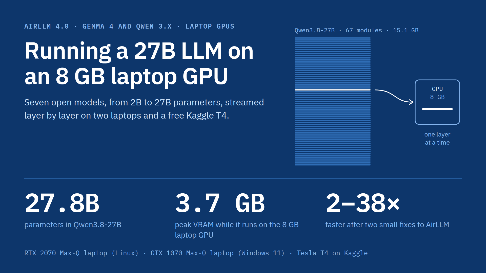
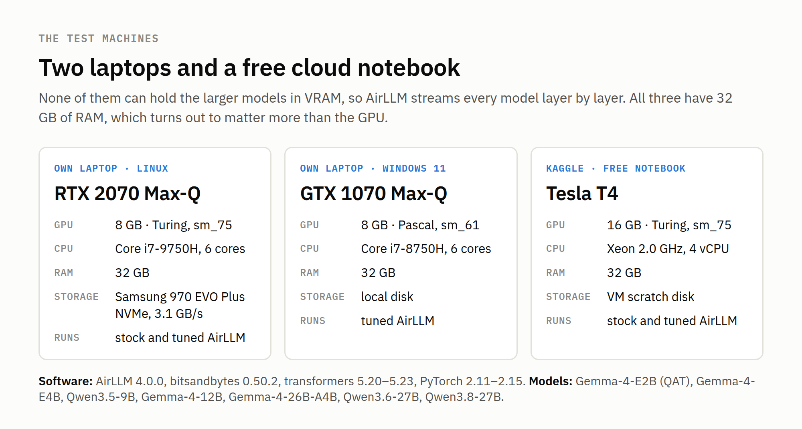
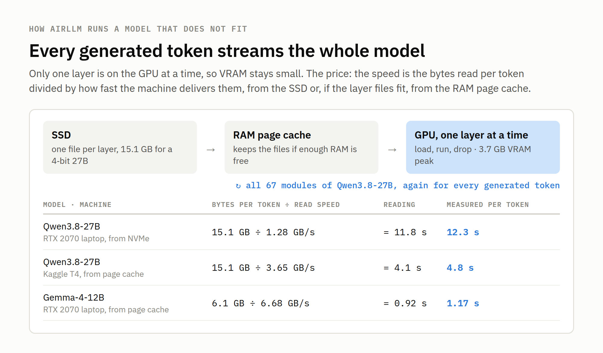
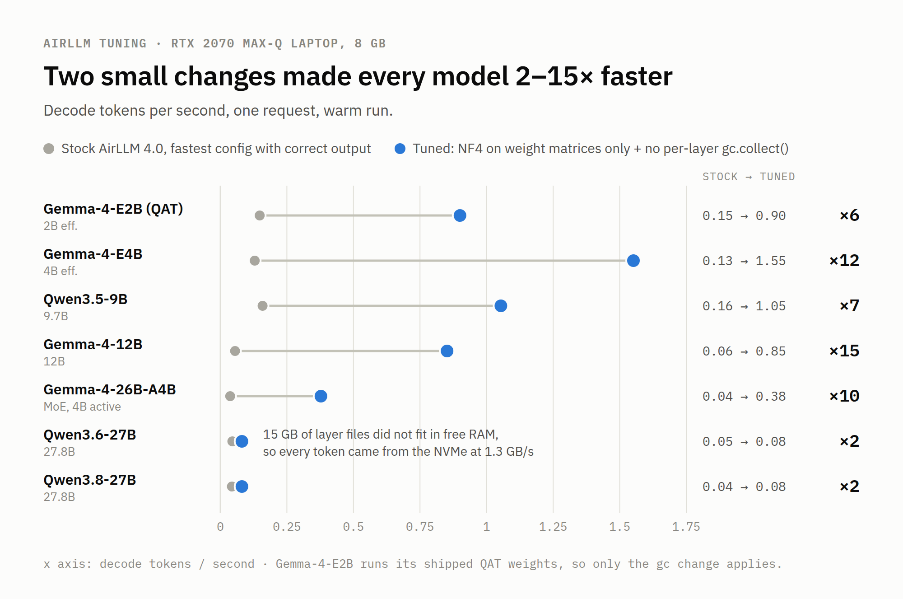
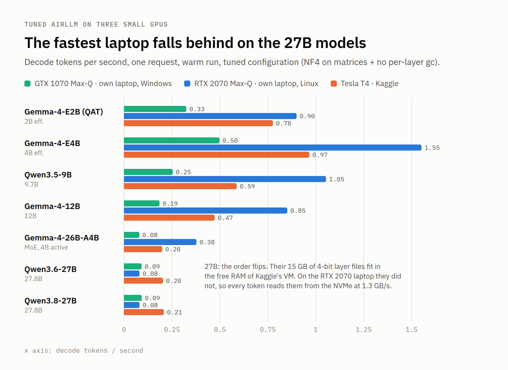
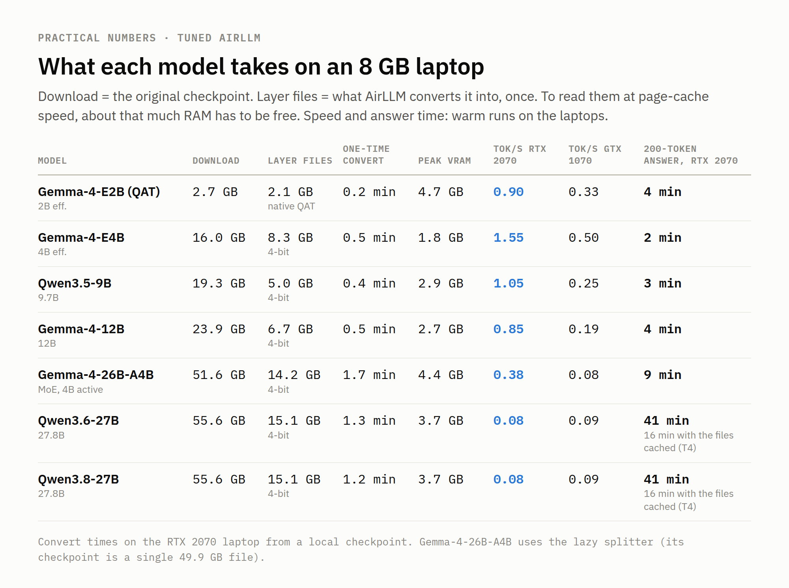
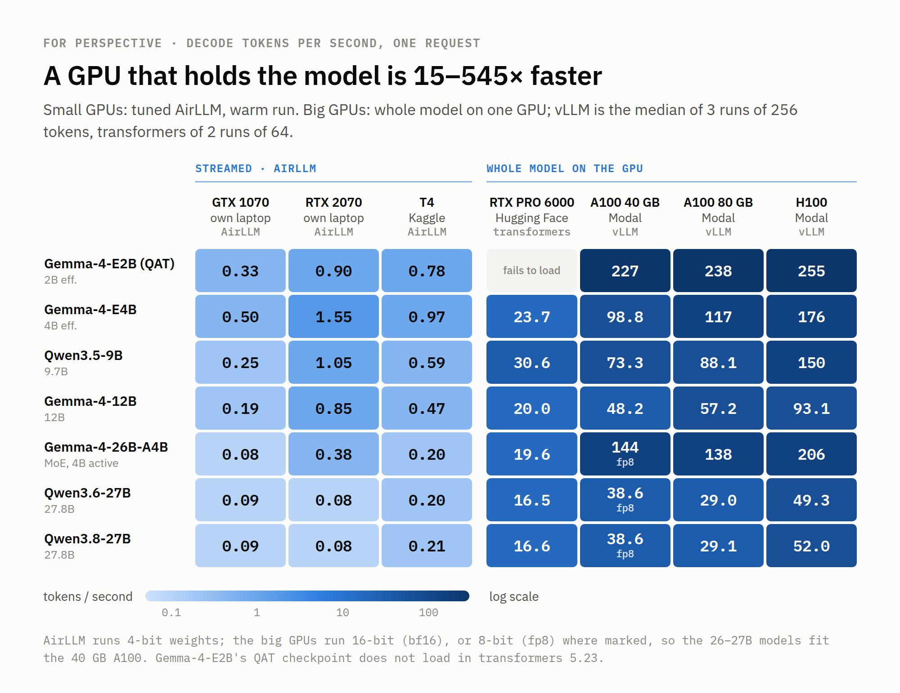

# Running a 27B LLM on an 8 GB Laptop GPU with AirLLM

## Seven Gemma 4 and Qwen 3.x models on two laptops and a free Kaggle T4, with vLLM on A100 and H100 GPUs as the reference

A 27B-parameter model needs about 55 GB for its weights at 16-bit precision. Most laptop GPUs have 6 or 8 GB of VRAM. AirLLM promises to close that gap by loading the model one layer at a time; its README advertises a 70B model on a 4 GB GPU.

I tested that promise with seven current open models, from Gemma-4-E2B to Qwen3.8-27B, on three machines: an RTX 2070 laptop (Linux), a GTX 1070 laptop (Windows 11) and a free Tesla T4 notebook on Kaggle. As a reference, I served the same models with vLLM on A100 and H100 GPUs rented from Modal. Every run used the same prompt and greedy decoding, and I measured decode speed: tokens generated per second for a single request.

**Key results**

- **It works.** Every model, including the 27B ones, ran in under 5 GB of VRAM.
- **Stock AirLLM is slow and partly broken.** It decodes at 0.01–0.16 tokens/s, and its 4-bit mode garbles Gemma 4.
- **Two small fixes make it 2–38× faster:** up to 1.6 tokens/s for the models up to 12B, and 0.08–0.4 tokens/s for the 26–27B models.
- **Free RAM matters more than the GPU.** The 27B models ran 2.5× faster on Kaggle's T4 than on my faster laptop, where their layer files did not fit in the RAM page cache.
- **A GPU that holds the whole model is in another league.** vLLM on an A100 or H100 decodes the same models at 29–255 tokens/s, which is 57–545× the best AirLLM result.

## The test machines

None of the three GPUs can hold the larger models, so AirLLM streams every model. The models are Gemma-4-E2B (Google's quantization-aware mobile checkpoint), Gemma-4-E4B, Qwen3.5-9B, Gemma-4-12B, Gemma-4-26B-A4B (a mixture-of-experts model with about 4B active parameters), Qwen3.6-27B and Qwen3.8-27B.

## How AirLLM works, and why it is slow

AirLLM converts a checkpoint once into one file per layer. At inference time it loads each layer from disk right before the layer runs, then drops it. Only one or two layers are on the GPU at any moment, so the VRAM needed depends on the largest layer, not on the model size. That is how Qwen3.8-27B runs in 3.7 GB.

The price is that every generated token streams the whole model again: 15.1 GB for a 4-bit 27B model. Speed then comes down to simple arithmetic:

**time per token ≈ bytes read per token ÷ read speed**

The read speed depends on where the layer files are. If they fit in free RAM, the operating system keeps them in its page cache and serves them at 3–7 GB/s. If not, every token reads them from the SSD again. With 4-bit weights, reading the layer files took 65–96% of each token's time in my runs. The GPU was never the bottleneck.

## Out of the box: slow and partly broken

Stock AirLLM 4.0 decoded at 0.01–0.16 tokens/s on the RTX 2070 laptop and the T4, which is 6–80 seconds per token. Three things failed:

- **Gemma 4 does not load.** AirLLM expects the decoder layers in a different place. I wrote a small adapter, which also handles Gemma's per-layer embedding table and its KV-shared layers.
- **The 4-bit mode garbles Gemma 4.** Asked how a CPU cache works, Gemma-4-E4B answered "pages page continues pagepsages…" and Gemma-4-12B repeated "februari februari". AirLLM quantizes every tensor, including normalization weights and per-layer scalars. Qwen tolerates that; Gemma 4 does not.
- **Gemma-4-26B-A4B cannot be converted.** Its checkpoint includes a single 49.9 GB file, and AirLLM's converter loads whole files. It ran out of RAM on the laptop and out of disk on Kaggle. I replaced it with a lazy splitter that reads one layer's bytes at a time, locally or straight from the Hugging Face Hub.

## Two fixes, 2–38× faster

1. **Quantize only the weight matrices.** Applying 4-bit NF4 to the matrices and leaving norms and scalars at 16-bit fixes Gemma 4 at the same file size. bitsandbytes, GPTQ and AWQ make the same choice.
2. **Remove the per-layer garbage collection.** AirLLM calls `gc.collect()` after every layer. With a transformers model in memory, one call takes about 0.1 s, which adds 4–7 s per token. Without it, Gemma-4-E2B went from 6.8 to 1.1 s per token, with identical output.

The second fix is what makes 4-bit pay off. In stock AirLLM, 4-bit reads 3.6× fewer bytes than 16-bit but is only 1.2–2× faster. With the garbage collection gone, it is 2.4–11× faster than 16-bit on the three models where I measured both, and it was the fastest configuration I measured for every model.

Compared with the fastest stock configuration that gives correct output, the tuned one is 2–15× faster on the RTX 2070 laptop and 5–38× faster on the T4.

## The machine around the GPU sets the speed

- **RTX 2070 laptop:** fastest for every model up to 26B. Its 4-bit layer files load from the Linux page cache at 5.4–6.7 GB/s.
- **Kaggle T4:** 1.2–1.9× slower on those models, despite the larger GPU. Its page cache delivers only 2.9–3.7 GB/s, probably limited by the notebook's 4 virtual CPUs.
- **GTX 1070 laptop:** 2.8–4.7× slower than the RTX 2070. Its layer files load at 1.5–1.9 GB/s, and the rest of each token (GPU compute and overhead) takes 3–11× longer. With one machine per operating system, I cannot separate the effect of Windows from that of the older GPU.
- **27B models:** the order flips. Their 15 GB of layer files fit in the free RAM of Kaggle's VM. On the RTX 2070 laptop, other applications had left only about 14 GB free, so every token came from the NVMe at 1.3 GB/s. Speed dropped to 0.08 tokens/s, behind the T4 (0.20) and even the GTX 1070 (0.09).

Mixture-of-experts brings no benefit here. AirLLM streams whole layers, so all 128 experts of Gemma-4-26B-A4B are read for every token, although only a few are used.

## What a laptop needs

- **VRAM:** 1.8–4.7 GB at peak. It is never the limit.
- **RAM:** the real requirement. For page-cache speed, the layer files must fit in free RAM: 5–7 GB for the 9–12B models and 15 GB for the 27B ones. Close memory-hungry applications first; there is no need to flush any cache.
- **Disk:** the download plus the layer files, about 70 GB for a 27B model. Conversion took under 2 minutes on the laptop.
- **Time:** at the measured rates, a 200-token answer takes 2–4 minutes for the models up to 12B and 9 minutes for Gemma-4-26B-A4B. A 27B model takes 41 minutes when read from the SSD, or 16 minutes from the page cache.

## The reference: vLLM on A100 and H100

On a GPU that holds the whole model, nothing is streamed. On Modal's A100 and H100, vLLM decoded the same models at 29–255 tokens/s, which is 57–545× the best AirLLM result for each model. Even plain transformers on a free Hugging Face ZeroGPU slice (an RTX PRO 6000) reached 16–31 tokens/s. All the A100 and H100 time cost under $10, covered by Modal's free monthly credit.

The comparison is not like for like. AirLLM ran 4-bit weights, while vLLM ran 16-bit ones (8-bit for the 26–27B models on the 40 GB A100). The 4-bit runs had less to read and still lost by two orders of magnitude. The arithmetic is the same as before, with different memory: an SSD or page cache delivers 1–7 GB/s, and an H100's HBM3 up to 3.35 TB/s.

## When AirLLM makes sense

Use it when a model does not fit your GPU, you need a few answers rather than a conversation, and the data must stay on your machine. Batch jobs, offline evaluation and trying a larger model before buying hardware all fit. It is not for chat, coding assistants or agents.

To get the most from it:

- Apply the two fixes.
- Keep enough RAM free for the layer files, and put them on an NVMe SSD.
- If a 4-bit version of the model fits in your VRAM (roughly up to 9–12B parameters on 8 GB), use a normal runtime such as llama.cpp instead. I did not measure that here, but with nothing to stream it should be far faster.

## Method and limitations

- One prompt ("Explain how a CPU cache works in one short paragraph."), greedy decoding, 32 new tokens (16 for the models above 25B), one run per configuration. The numbers measure speed, not answer quality.
- Speeds come from the warm run: a second, identical generation, after the layer files had a chance to enter the page cache.
- "Correct" means coherent and on topic, judged by reading every output. I did not measure how much 4-bit quantization affects quality.
- The stock baseline is the fastest unmodified configuration with correct output: 16-bit for Gemma 4 and 4-bit for Qwen.
- The GTX 1070 ran only the tuned configuration. On Windows I could not confirm whether its layer files were served from the file cache, and its VRAM figures cover the whole GPU, desktop included.
- vLLM numbers are the median of three 256-token runs.
- Software: AirLLM 4.0.0, bitsandbytes 0.50.2, transformers 5.20–5.23, PyTorch 2.11–2.15, vLLM 0.34.

Code and raw results, including the Gemma 4 adapter, the lazy splitter and both fixes: [github.com/hannan72/airllm-benchmarks](https://github.com/hannan72/airllm-benchmarks)

*Have you run large models on a laptop GPU, with AirLLM or anything else? I would like to hear what worked for you.*
